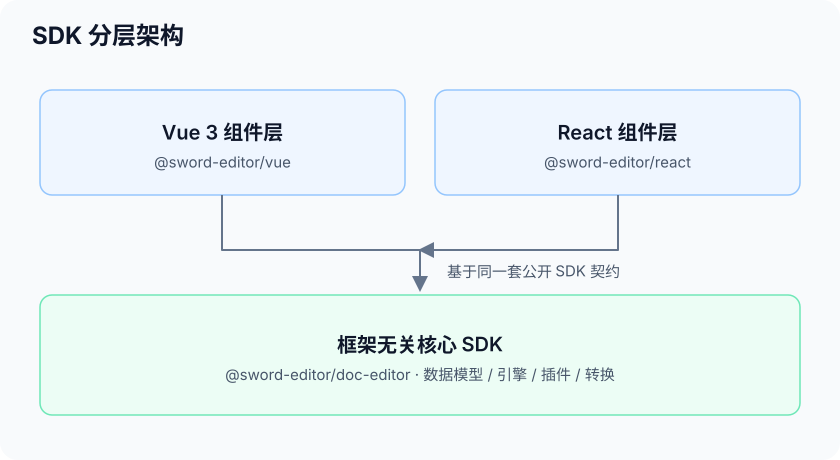

# Sword Editor

框架无关的编辑器 SDK 与 Vue 3 / React 组件库，当前覆盖**文档编辑器**与**图片编辑器**。仓库地址：<https://github.com/wty9sky/ai-text-editor>

文档站：<https://wty9sky.github.io/ai-text-editor/>（推送到 `main` 自动重新部署）。



核心层（`@sword-editor/doc-editor`、`@sword-editor/image-editor`、`@sword-editor/runtime`）只处理数据、命令与插件，不含 UI；Vue 与 React 组件层负责渲染和交互。领域插件逻辑可两端复用，渲染器按框架分别实现。

## 特性

- **块模型**：最小内容单元 `{ id, type, text, props? }`，内置文本、标题 H1–H3、有序/无序列表、引用、代码块、图片、视频、附件、分割线等块类型。
- **Markdown 双向转换**：`markdownToBlocks` / `blocksToMarkdown` / `markdownToHtml`；组件层同时支持 Markdown 与 JSON 受控接口。
- **插件体系**：`definePlugin` / `defineExtension`，提供块类型、命令、渲染器、工具栏、右键菜单、导出器、上传器、AI 操作等扩展点；插件依赖支持 SemVer 与拓扑预检。
- **编辑器引擎**：多选、undo/redo、冻结 JSON 快照、类型化生命周期/命令/事务/AI 钩子、具名发布订阅与有限诊断；旧 `editor.on` 保持兼容。
- **上传与导出**：`createFunctionUploader` / `createActionUploader`；内置 md / docx / pdf / png 导出器。
- **AI 接入**：`createAiAdapter` 通过配置接入 OpenAI 兼容模型，也可手写 `AiAdapter` 或自定义 `AiAction`。
- **主题**：组件自带亮色/深色基础主题，以 CSS 变量表达颜色，覆盖同名变量即可换肤。
- **发布工程**：pnpm workspace + VitePress 文档站 + GitHub Actions（CI、Pages 部署、npm 发布）+ tsc 后 SDK 混淆；发布前自动校验包内容与独立消费工程。

## 包一览

| 目录 | npm 包 | 职责 | 本次发布范围 |
| --- | --- | --- | --- |
| `packages/runtime` | `@sword-editor/runtime` | 公共插件运行时、事件总线 | 是（SDK 依赖） |
| `packages/doc-editor` | `@sword-editor/doc-editor` | 文档模型、命令、历史、Markdown 转换、导出 | 是 |
| `packages/image-editor` | `@sword-editor/image-editor` | 多图层图片模型与 Canvas2D 渲染工作台 | 是 |
| `packages/vue` | `@sword-editor/vue` | Vue 3 文档/图片编辑器组件集合 | 是 |
| `packages/react` | `@sword-editor/react` | React 文档/图片编辑器组件集合 | 是 |
| `packages/canvas-editor` | `@sword-editor/canvas-editor` | 无限画布 SDK | 否（暂不打包发布） |
| `apps/docs` | 不发布 | VitePress 文档站与 Playground | 仅部署 GitHub Pages |

组件包在构建期把文档/图片 SDK、runtime、图标与导出依赖内联进产物，并把类型打进 `dist/index.d.ts`；因此使用组件时**只需安装一个组件包**，不需要也不建议再单独安装 `@sword-editor/doc-editor` 等 SDK，否则可能出现类身份（如 `instanceof`）不一致。

## 目录结构

```text
.
├── apps/docs/                  # 文档站与 Playground（VitePress）
├── packages/
│   ├── runtime/                # 公共运行时
│   ├── doc-editor/             # 文档 SDK（tsc → 混淆）
│   ├── image-editor/           # 图片 SDK（tsc → 混淆）
│   ├── canvas-editor/          # 无限画布 SDK（当前不发布）
│   ├── vue/                    # Vue 组件库（Vite library mode）
│   └── react/                  # React 组件库（Vite library mode）
├── scripts/                    # 包检查、混淆、发布编排脚本
├── docs/github-and-npm.md      # GitHub 部署与 npm 发布完整流程
└── .github/workflows/          # CI / Pages 部署 / npm 发布
```

## 环境要求

- Node `>=22.12.0`
- pnpm `>=10`（仓库固定 `pnpm@10.24.0`）
- 浏览器冒烟测试默认使用 macOS Google Chrome，可用 `CHROME_PATH` 指定可执行文件

## 本地开发

```sh
pnpm install
pnpm dev            # 并行启动各包开发任务
pnpm docs:dev       # 文档站，默认 http://localhost:5174
pnpm build          # 全仓构建
pnpm release:check  # 构建 + 类型 + 测试 + 包内容检查
pnpm test:browser   # Chrome 浏览器回归
```

## 安装与接入

### Vue 3

宿主提供 Vue `^3.5`，无需安装第三方 UI 库。

```sh
pnpm add @sword-editor/vue
```

```vue
<script setup lang="ts">
import { ref } from 'vue'
import { DocEditor } from '@sword-editor/vue'
import '@sword-editor/vue/style.css'

const markdown = ref('# 你好\n\n这是一段文字')
</script>

<template>
  <DocEditor v-model="markdown" />
</template>
```

`v-model` 绑定 Markdown 字符串，内部完成 Markdown ↔ 块的双向转换；需要 JSON 时使用 `v-model:document`。插件工厂、上传器工厂和类型都从同一包导入：

```ts
import { createFunctionUploader, definePlugin } from '@sword-editor/vue'
import type { DocumentEditorPlugin } from '@sword-editor/vue'
```

### React

宿主提供 React / ReactDOM `>=18`。

```sh
pnpm add @sword-editor/react
```

```tsx
import { useState } from 'react'
import { DocEditor } from '@sword-editor/react'
import '@sword-editor/react/style.css'

function App() {
  const [markdown, setMarkdown] = useState('# 你好\n\n这是一段文字')
  return <DocEditor value={markdown} onChange={setMarkdown} />
}
```

### 独立使用 SDK

不使用 UI、只需数据与命令时安装 headless SDK：

```sh
pnpm add @sword-editor/doc-editor
```

```ts
import { Editor, markdownToBlocks, blocksToMarkdown, definePlugin } from '@sword-editor/doc-editor'

const blocks = markdownToBlocks('# 标题\n\n一段正文')
const editor = new Editor({ plugins: [] })
editor.setBlocks(blocks)
editor.update(editor.blocks[0].id, { text: '修改后的内容' })
editor.undo()
const json = editor.toDocument()
const markdown = blocksToMarkdown(editor.blocks)
editor.destroy()
```

### 图片编辑器

组件包导出 `ImageEditor`；SDK 提供 headless 工作台挂载函数：

```vue
<script setup lang="ts">
import { ImageEditor } from '@sword-editor/vue'
</script>

<template>
  <ImageEditor />
</template>
```

```ts
import { mountImageWorkbench } from '@sword-editor/image-editor'
import type { ImageDocument } from '@sword-editor/image-editor'

const workbench = mountImageWorkbench(hostElement, initialDocument)
// 结束时调用 workbench.destroy()
```

### 接入注意事项

- 样式必须从 `@sword-editor/vue/style.css` 或 `@sword-editor/react/style.css` 显式引入一次。
- 组件在客户端挂载时创建内部 Editor，卸载时清理；SSR 页面请使用 ClientOnly。
- 上传、导出等依赖 DOM 的能力仅在浏览器调用；示例上传接口 `/api/upload` 需由宿主实现并返回 `{ url: string }`。
- 插件、上传器、导出器和 AI 配置在挂载时读取；更换配置应重新挂载组件。不要在挂载期间主动 `destroy()` ref 暴露的实例。
- SDK 的格式标识保持既有 `site.*`，以保留文档兼容性。

## 核心概念

| 概念 | 说明 |
| --- | --- |
| 块（Block） | 最小内容单元 `{ id, type, text, props? }` |
| 块类型（BlockTypeDef） | `parse`（Markdown → 块）、`serialize`（块 → Markdown）、`leaf` |
| 插件（Plugin） | 能力打包单元，在 `install(ctx)` 中注册扩展点 |
| 扩展点 | 块类型 / 命令 / 渲染器 / 工具栏 / 右键菜单 / 导出器 / 上传器 / AI 操作 |
| PluginManager | 装载、卸载插件并聚合扩展点 |
| Editor | 引擎：块列表 + 多选 + undo/redo + 事件 |

## 文档索引

**SDK**

| 文档 | 内容 |
| --- | --- |
| [SDK 概述](apps/docs/sdk/index.md) | 分层架构、安装方式、最小示例 |
| [Editor 引擎](apps/docs/sdk/editor.md) | 块操作、多选、历史、事件 |
| [数据与持久化](apps/docs/sdk/document.md) | JSON 校验、冻结快照、受控同步 |
| [插件体系](apps/docs/sdk/plugin.md) / [插件契约](apps/docs/sdk/plugin-guide.md) | `definePlugin` 与扩展点协议 |
| [钩子与发布订阅](apps/docs/sdk/hooks.md) | 类型化决策、具名通知、AI 准备与诊断 |
| [生命周期](apps/docs/sdk/lifecycle.md) | 状态、取消、安装回滚与销毁 |
| [消息通道](apps/docs/sdk/messages.md) / [托管资源](apps/docs/sdk/resources.md) | 插件间通知与资源清理 |
| [上传](apps/docs/sdk/upload.md) / [AI 接入](apps/docs/sdk/ai.md) | 上传器工厂与 AI 适配器 |
| [能力边界](apps/docs/sdk/plugin-boundaries.md) | 权限、性能与隔离限制 |

**Vue 组件**

| 文档 | 内容 |
| --- | --- |
| [快速开始](apps/docs/vue/getting-started.md) | 安装、最小接入、上传与插件 |
| [DocEditor](apps/docs/vue/doc-editor.md) / [编辑区](apps/docs/vue/editor.md) / [工具栏](apps/docs/vue/tool-bar.md) | 组件 Props 与组合方式 |
| [自定义块](apps/docs/vue/custom-blocks.md) / [AI 接入](apps/docs/vue/ai.md) | 渲染器与 AI 配置 |

**React 组件**

| 文档 | 内容 |
| --- | --- |
| [快速开始](apps/docs/react/getting-started.md) | 安装、最小接入、上传与插件 |
| [DocEditor](apps/docs/react/doc-editor.md) / [编辑区](apps/docs/react/editor.md) / [工具栏](apps/docs/react/tool-bar.md) | 组件 Props 与组合方式 |
| [自定义块](apps/docs/react/custom-blocks.md) / [AI 接入](apps/docs/react/ai.md) | 渲染器与 AI 配置 |

**编辑器与 Playground**：[图片编辑器](apps/docs/editors/image.md)、[无限画布](apps/docs/editors/canvas.md)、[Playground 总览](apps/docs/playground.md)、[文档](apps/docs/playground/document.md)、[图片](apps/docs/playground/image.md)、[富文本](apps/docs/playground/rich-text.md)、[画布](apps/docs/playground/canvas.md)。

## 命令参考

| 命令 | 作用 |
| --- | --- |
| `pnpm dev` | 并行启动各包开发任务 |
| `pnpm build` | 构建全部工作区包（含无限画布与文档站依赖） |
| `pnpm typecheck` | 全仓类型检查 |
| `pnpm lint` | ESLint 检查 |
| `pnpm test` | 全仓单元测试 |
| `pnpm test:browser` | Chrome 浏览器回归测试 |
| `pnpm test:packages` | 用临时 Vue/React 消费工程验证组件 tarball |
| `pnpm docs:dev` / `pnpm docs:build` | 文档站开发 / 生产构建 |
| `pnpm release:check` | 全仓构建、类型、测试与包内容检查 |
| `pnpm release:scope:build` | 仅构建本次发布范围内的 5 个包 |
| `pnpm release:scope:check` | 范围构建 + 类型 + SDK 测试 + 混淆标记 + 独立消费工程验证 |
| `pnpm release:scope:pack` | 校验通过后生成 tarball 到 `.artifacts/npm/` |
| `pnpm release:scope:publish` | 校验通过后按依赖顺序发布 5 个包（需要 npm 登录） |
| `pnpm clean` / `pnpm watch` | 清理产物 / 监视构建 |

## GitHub 部署与 npm 发布

| 工作流 | 触发 | 作用 |
| --- | --- | --- |
| `.github/workflows/ci.yml` | 推送 `master`/`main`、PR | 构建、类型、测试、文档构建、包检查 |
| `.github/workflows/deploy-docs.yml` | 推送 `master`/`main`、手动 | 部署 `apps/docs` 到 GitHub Pages |
| `.github/workflows/publish-npm.yml` | GitHub Release 发布、手动输入 `publish` | 仅打包并发布本表内的 5 个包 |

发布范围由 `scripts/publish-config.mjs` 统一管理：包含 runtime、doc-editor、image-editor、vue、react；`canvas-editor` 暂不打包发布。SDK 在 `tsc` 之后由 `scripts/obfuscate-dist.mjs` 混淆 `dist/*.js`，`.d.ts` 与具名导出保持不变；Vue/React 构建期内联已混淆的 SDK，因此安装后 `import { Editor, DocEditor, ... }` 的调用方式不变。混淆配置见 `scripts/obfuscate-config.mjs`，混淆用于提高阅读成本，不构成安全边界。

首次推送、Pages 配置、`NPM_TOKEN`、版本升级与发版命令的完整流程见 [docs/github-and-npm.md](docs/github-and-npm.md)。

## 当前边界

- 无限画布 SDK 存在于仓库与文档中，但不在本次 npm 发布范围内。
- 图片 SDK 提供 headless 工作台，组件层的图片 UI 仍较基础；画布/图片的完整产品 UI 待后续开发。
- 暂无协作一致性协议；受限插件门面与能力门禁不构成不可信 JavaScript 的安全沙箱。
- 外部实例所有权、动态配置替换、只读交互等能力仍在演进中。

## 许可

各发布包采用 MIT 许可，详见包内 `LICENSE` 文件。
